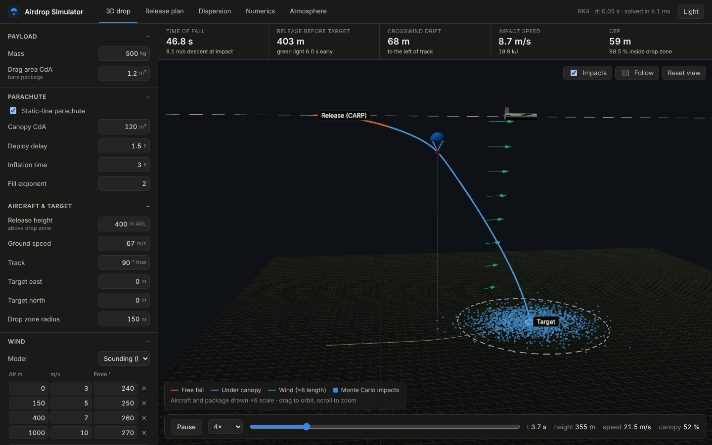
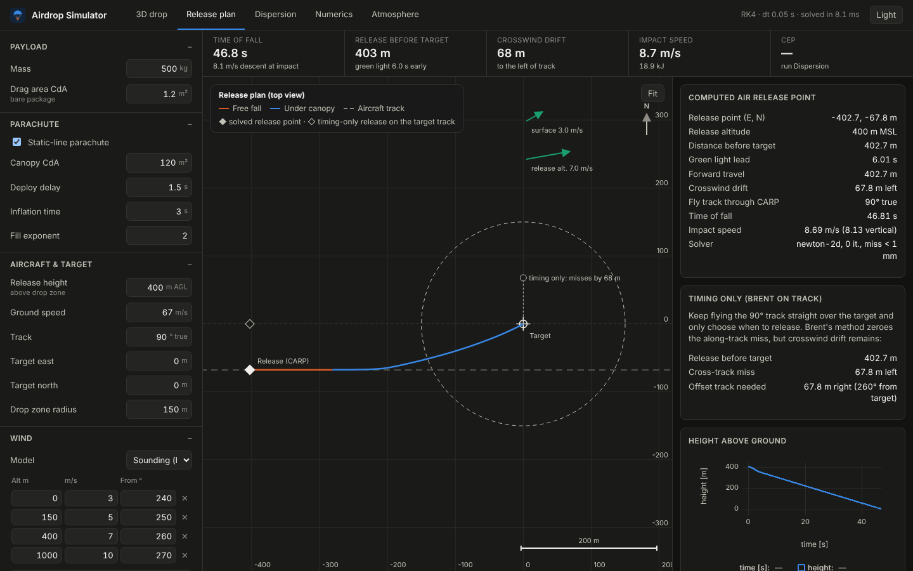
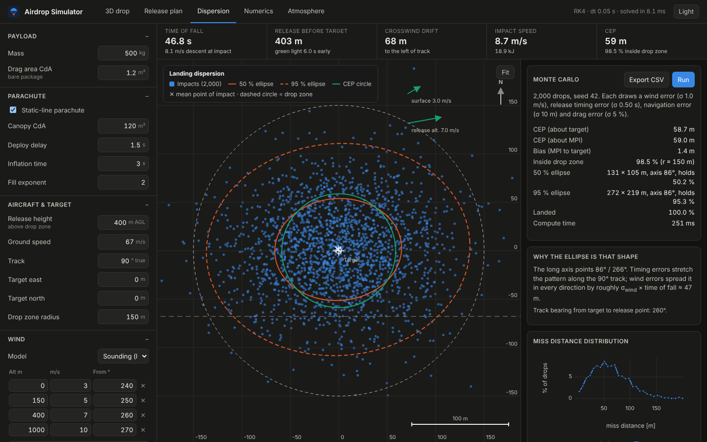
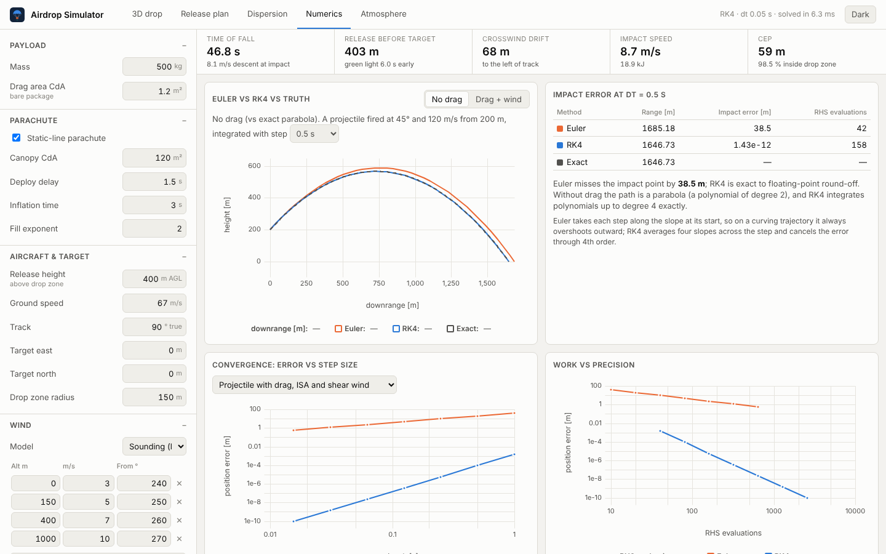
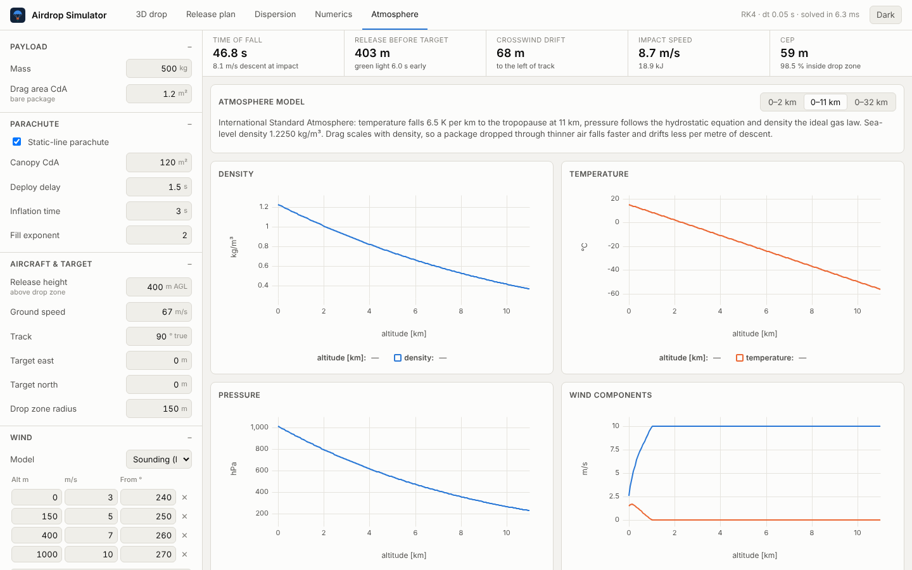

# Trajectory and Airdrop Simulator

A desktop app for planning a parachute supply drop. It simulates the package
through a standard atmosphere and layered winds. It computes where the aircraft
must release the package to hit the drop zone, and shows the landing spread
under uncertainty, all in an interactive 3-D view.

Built with a **Rust physics engine** and a **Tauri + React** interface. The
numerical methods are written by hand and checked against exact solutions by
the test suite.



## What it does

| Tab | What you get |
| --- | --- |
| **3D drop** | Animated aircraft, release, canopy inflation and descent over terrain, with wind arrows and Monte Carlo impacts. Orbit, follow-cam, scrub the timeline. |
| **Release plan** | Top-down computed air release point (CARP): solved release point, aircraft track, drift, green-light lead time, plus the "timing only" solution that shows the crosswind miss you get without offsetting the track. |
| **Dispersion** | Monte Carlo over wind, timing, navigation and drag errors. 50 % / 95 % ellipses, CEP, probability of landing in the drop zone, CSV export. |
| **Numerics** | Euler vs RK4 vs exact solution, convergence (error vs step size, log-log) and work-vs-precision plots. |
| **Atmosphere** | ISA density, temperature, pressure and the wind profile. |

Every number in the UI updates live as you edit the scenario (a drop solves in
about 6 ms; 2,000 Monte Carlo drops take about 0.25 s).

| Release plan | Landing dispersion |
| --- | --- |
|  |  |

| Numerics | Atmosphere |
| --- | --- |
|  |  |

## The finish line, proven by tests

`cargo test` runs 33 tests. The ones the project plan asked for:

- **RK4 beats Euler at every equal step size**, by more than 100×
  (`rk4_beats_euler_at_every_equal_step_size`).
- **Observed orders are 1 and 4** against the exact tanh drag solution
  (`observed_orders_are_one_and_four`), and on the full model with ISA, drag and
  shear wind (`full_model_converges_at_design_order`).
- **RK4 still wins at equal work**, with Euler given 4× the steps
  (`rk4_beats_euler_at_equal_work`).
- RK4 hits the vacuum parabola to round-off (impact error 1e-12 m).
- ISA matches the published tables to 0.1 %.
- The release solver lands within 1 cm of the target, including on a hill with
  position-dependent wind, where Newton needs several iterations.
- The 95 % ellipse holds 95 ± 3 % of the Monte Carlo samples; same seed gives
  same result.
- An unstable step size (Euler at 1 s through canopy opening) is reported as an
  error, never as a confident wrong release point.

Measured convergence (`airdrop numerics`):

```
Projectile with drag, ISA and shear wind (error at t = 10 s)
     dt [s]      Euler [m]        RK4 [m]
    1.00000        3.882e1       1.594e-3
    0.50000        1.924e1       9.489e-5
    0.25000        9.580e0       5.774e-6
    0.12500        4.780e0       3.558e-7
    0.06250        2.388e0       2.208e-8
  observed order: Euler 1.00, RK4 4.01
```

## Physics

Point mass with gravity and quadratic drag on the air-relative velocity,
International Standard Atmosphere (to 86 km, hot/cold days), uniform /
power-law / layered winds, static-line parachute with a power-law inflation
model, and flat / hill / gridded (DEM-ready) terrain. The full derivation is in
[docs/physics.md](docs/physics.md).

## Run it

Prerequisites: [Rust](https://rustup.rs), Node 20+, and the
[Tauri system dependencies](https://v2.tauri.app/start/prerequisites/) for your
OS (WebView2 on Windows is already installed on Windows 10/11).

```bash
npm install
npm run tauri dev        # desktop app with hot reload
npm run tauri build      # installer for your OS (.msi/.exe, .dmg, .deb/.AppImage)
```

Pushing a tag such as `v0.1.0` builds Windows, macOS and Linux installers in
GitHub Actions and attaches them to a draft release.

### Command line

The same engine has a CLI, handy for scripting and batch runs:

```bash
cargo run --release -p airdrop-cli -- scenario > drop.json   # editable template
cargo run --release -p airdrop-cli -- drop -s drop.json
cargo run --release -p airdrop-cli -- montecarlo -s drop.json -n 10000
cargo run --release -p airdrop-cli -- numerics
cargo run --release -p airdrop-cli -- profile --csv
```

Add `--json` to any report for machine-readable output. Scenario files are the
same JSON the app's **Save…** button writes.

## Layout

```
crates/airdrop-core/   physics library (no UI dependencies), all tests
  src/atmosphere.rs    ISA
  src/wind.rs          wind models and direction conventions
  src/dynamics.rs      equations of motion, parachute
  src/integrate.rs     Euler, RK4, Hermite impact location, divergence guard
  src/analytic.rs      exact solutions
  src/convergence.rs   error-vs-step studies, observed order
  src/roots.rs         Brent's method, damped 2-D Newton
  src/release.rs       release point (CARP) solver
  src/montecarlo.rs    parallel dispersion, ellipses, CEP
  src/scenario.rs      serializable scenario and the reports the app shows
crates/airdrop-cli/    `airdrop` command-line tool
src-tauri/             desktop shell: async commands over the core
src/                   React + TypeScript UI (three.js scene, uPlot charts, SVG map)
scripts/screenshots.mjs  UI smoke test that also regenerates docs/img
```

## Why Rust + Tauri

- **Rust core.** Hand-written integrators run at native speed, so Monte Carlo
  stays interactive without vectorisation tricks. The type system keeps units
  and models explicit, and the core has no UI dependencies, so the same crate
  can later feed a drone simulator, a tracker or a server.
- **Tauri.** A native desktop app of a few MB (Electron ships a whole
  browser), with a web UI so three.js and modern charting are available.
- **No numerical black boxes.** Euler, RK4, Brent and Newton are implemented
  here rather than imported, because comparing them is the point.

## Limits

This is an educational and planning-study tool, not certified mission
software. It uses a point-mass model (no canopy oscillation, glide, or
package tumbling), the wind is a forecast profile plus a random offset, and
the parachute inflation model is a simple power law. Real airdrop systems use
measured ballistic data for specific canopies.

## Stretch goals

- Terrain from real elevation data (the `Terrain::Grid` type is the hook)
- Canopy opening shock loads and oscillation (6-DOF)
- Wind uncertainty correlated across altitude layers
- Steerable (guided) parachutes

## License

MIT
