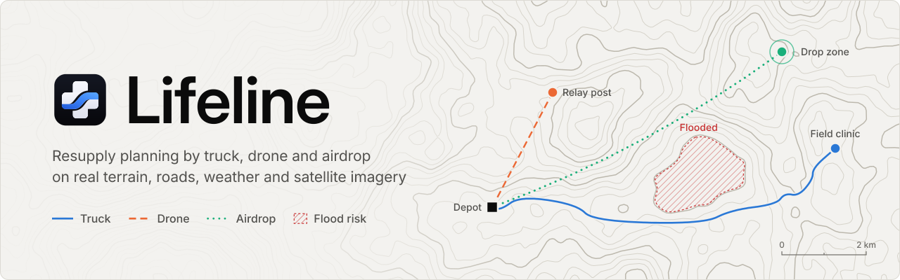
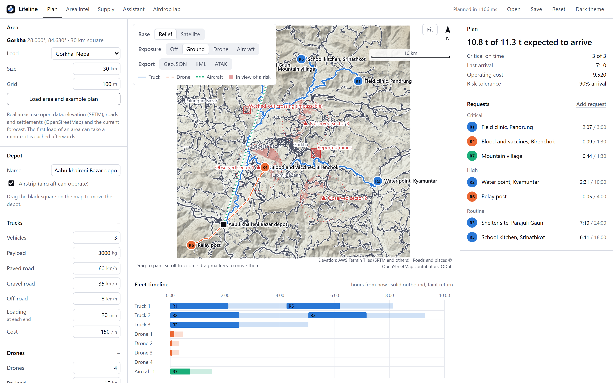
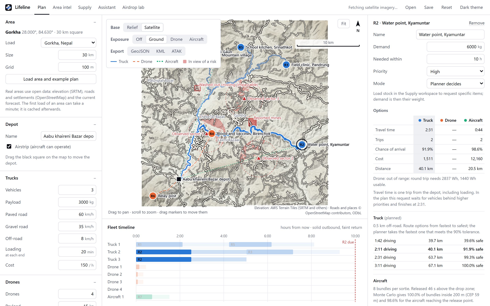
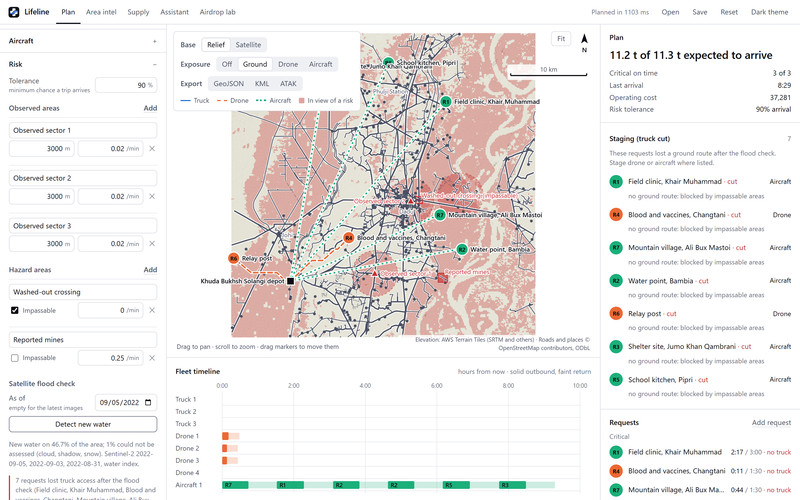
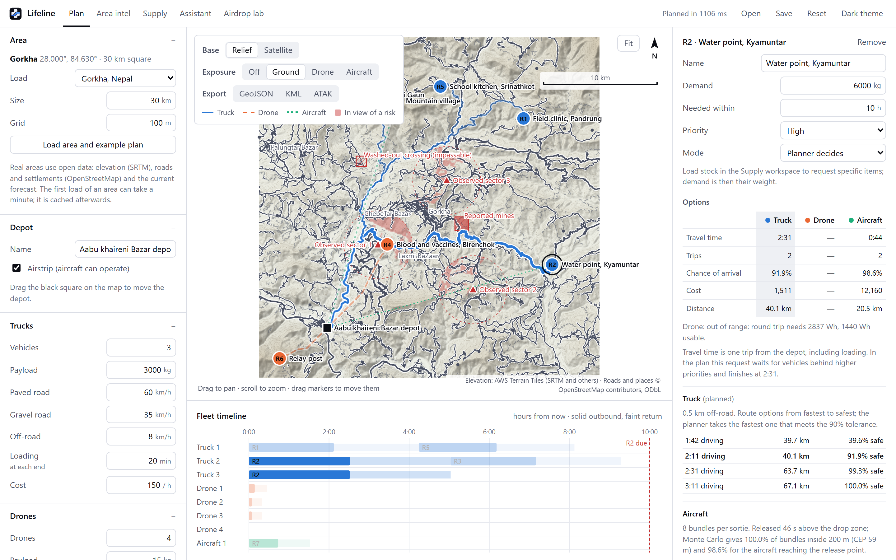
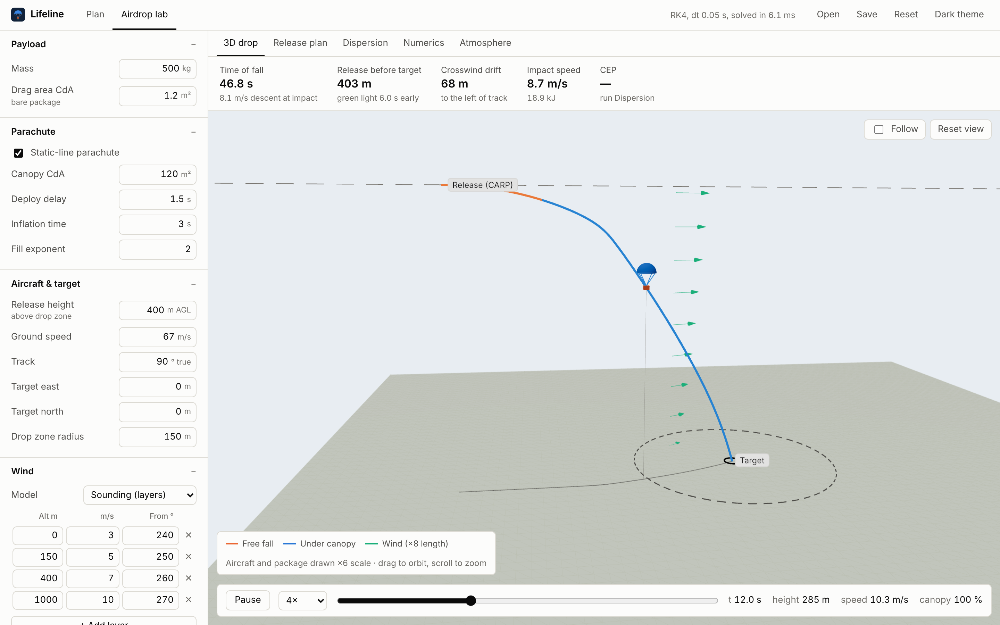

<picture>
  <source media="(prefers-color-scheme: dark)" srcset="docs/brand/banner-dark.svg">
  
</picture>

<p align="center">
  <a href="#download">Download</a> ·
  <a href="#quick-start">Quick start</a> ·
  <a href="#recognising-floods-from-satellite-images">Flood recognition</a> ·
  <a href="docs/physics.md">Physics</a> ·
  <a href="ml/README.md">Model training</a> ·
  <a href="#building-from-source">Build</a>
</p>

<p align="center">
  <a href="https://github.com/sekaikx/lifeline/actions/workflows/ci.yml"></a>
  <a href="LICENSE"></a>
</p>

# Lifeline

Lifeline is an open-source resupply planner for disaster response and
contested logistics. It decides how to get supplies to places that are hard or dangerous to
reach: by truck on the real road network, by drone, or by parachute airdrop.
It works on real terrain, OpenStreetMap roads, live weather forecasts and
Sentinel-2 satellite imagery, recognises flooded land with a trained neural
network, and produces a schedule that says which vehicle goes where, when the
supplies arrive, how likely they are to arrive intact, and what it costs.

It is built for the planning cell of a relief operation, or a logistics unit
working where roads are cut, the weather matters and some areas are unsafe.
It runs on one laptop (Windows, macOS, Linux) and keeps working offline once
an area has been loaded.



## Download

Installers for Windows, macOS and Linux are attached to each
[release](https://github.com/sekaikx/lifeline/releases/latest). Lifeline is
free and has no account, telemetry or licence key.

| System | File | Notes |
| --- | --- | --- |
| Windows 10 and 11, 64-bit | [`Lifeline_0.1.0_x64-setup.exe`](https://github.com/sekaikx/lifeline/releases/latest) | Installer, the usual choice |
| | [`Lifeline_0.1.0_x64_en-US.msi`](https://github.com/sekaikx/lifeline/releases/latest) | MSI package, for managed deployment |
| macOS, Apple silicon and Intel | [`Lifeline_0.1.0_universal.dmg`](https://github.com/sekaikx/lifeline/releases/latest) | Disk image; drag Lifeline to Applications |
| Debian 12+, Ubuntu 22.04+ | [`Lifeline_0.1.0_amd64.deb`](https://github.com/sekaikx/lifeline/releases/latest) | Debian package; install with apt |
| Fedora, RHEL, openSUSE | [`Lifeline-0.1.0-1.x86_64.rpm`](https://github.com/sekaikx/lifeline/releases/latest) | RPM package; install with dnf or zypper |
| Other Linux, x86-64 | [`Lifeline_0.1.0_amd64.AppImage`](https://github.com/sekaikx/lifeline/releases/latest) | Make it executable (`chmod +x`), then run it |

The installers are not code-signed yet, so Windows and macOS warn the first
time you open Lifeline.

<details>
<summary>Opening an unsigned build on Windows and macOS</summary>

<br>

On Windows, SmartScreen shows "Windows protected your PC". Choose *More
info*, then *Run anyway*. This happens once per download.

On macOS, Gatekeeper refuses to open the app on the first try. Open
*System Settings > Privacy & Security*, scroll to *Security*, choose *Open
Anyway* next to the message about Lifeline and confirm. On macOS 14 and
earlier, Control-clicking the app in Finder and choosing *Open* does the
same. If macOS instead says the app "is damaged", the download has been
quarantined; clear the flag and open it again:

```bash
xattr -dr com.apple.quarantine /Applications/Lifeline.app
```

If you would rather not run an unsigned binary, [build it from
source](#building-from-source).

</details>

Loading a new area needs an internet connection; after that the area works
offline. The trained flood model is not included (see
[below](#recognising-floods-from-satellite-images)), so out of the box the
flood check uses the water index.

## Quick start

What to try in the first five minutes.

1. Open Lifeline. It starts on a generated valley, so there is a plan to
   look at before anything is downloaded.
2. In *Area* at the top left, set *Load* to *Gorkha,
   Nepal* and press *Load area and example plan*. The first load fetches
   elevation, roads, settlements and the wind forecast for a 30 km square and
   takes a minute or so; later loads come from the cache.
3. Read the plan. The panel on the right starts with how much of the
   demand is expected to arrive, then whether the critical requests are on
   time, the last arrival, the operating cost and the risk tolerance. Below
   it, requests are grouped by priority with their arrival time against the
   deadline. Click one to compare its truck, drone and airdrop options side by
   side. The fleet timeline under the map shows what every vehicle is doing,
   hour by hour. Switch *Exposure* on the map to *Ground*, *Drone* or
   *Aircraft* to see what the observed areas can see at each height.
4. Try the flood check. Load *Dadu, Pakistan*, a 40 km square on the
   Indus. Under *Risk*, in *Satellite flood check*, set *As of* to
   5 September 2022 and press *Detect new water*. Newly flooded land is
   added as an impassable area and the plan is recomputed around it. Repeat
   with 5 September 2021 to see the same ground a year before the flood.
5. *Save* writes the scenario as JSON. *Open* reads it back, and
   the [`lifeline` command](#command-line) plans the same file.

Everything on the map can be dragged: the depot, requests and observed areas.
The plan updates as you go.

## What it does

1. Load any place. Pick a preset or a latitude and longitude. Lifeline
   downloads the elevation, the road network and settlements, and a wind
   forecast, then proposes example deliveries to real villages.
2. Mark what is unsafe. An observed area (a checkpoint, a hostile
   position, a crowd) puts at risk what it can see; Lifeline computes that
   from the terrain for vehicles on the ground, drones at cruise height and
   aircraft at drop height. Hazard zones close roads or add risk. The flood
   check marks newly flooded land from recent satellite images and closes
   the roads that cross it.
3. Compare three ways to deliver. Every request gets a truck, a drone and
   an airdrop option, each with its time, trips, probability of arrival and
   cost.
4. Get a schedule. Requests are served by priority, then deadline. Each
   gets the cheapest option that meets the risk tolerance and arrives on
   time; failing that, the earliest; failing that, the safest. A simple rule
   a planner can follow and defend, not a black box.

| | Truck | Drone | Airdrop |
| --- | --- | --- | --- |
| Path | OpenStreetMap roads, off-road legs where no road reaches | Straight or detoured flight over the terrain | Aircraft track to a computed release point |
| Limited by | Road class, gradient, closed roads | Battery energy, wind, radio line of sight | Wind, release timing, drop zone size |
| Risk | Exposure along the route, trading time against safety | Exposure at cruise height | Exposure at drop height, chance of landing in the zone |
| Good for | Bulk loads on open roads | Small urgent loads: blood, vaccines | Places no road reaches in time |

| Satellite layer over Gorkha | Flood check, Dadu, September 2022 |
| --- | --- |
|  |  |
| **Truck, drone and airdrop compared for one request** | **Airdrop lab: release point and descent in 3-D** |
|  |  |

## A worked example

The default Gorkha scenario has a depot with an airstrip, seven requests
ranging from a field clinic to a mountain village far from any road, three
observed areas overlooking the paved roads, a washed-out crossing and a
reported minefield on unpaved roads, and the current MET Norway wind
forecast. The plan takes well under a second:

```
$ lifeline example --lat 28.0 --lon 84.63 --size-km 30 --name Gorkha > gorkha.json
$ lifeline plan -s gorkha.json

id   request                                kg priority  mode      trips  arrives    due P(arrive)
R1   Field clinic, Pandrung                350 critical  Truck         1     2:07   3:00     99.3%
R2   Water point, Kyamuntar               6000 high      Truck         2     2:31  10:00     91.9%
R3   Shelter site, Parajuli Gaun          2500 routine   Truck         1     7:10  24:00     99.3%
R4   Blood and vaccines, Birenchok          12 critical  Drone         1     0:09   1:30     99.8%
R5   School kitchen, Srinathkot            900 routine   Truck         1     6:11  18:00     99.3%
R6   Relay post                             25 high      Drone         2     0:04   4:00    100.0%
R7   Mountain village                     1500 critical  Aircraft      1     0:44   1:30     99.2%

expected delivered 10764 of 11287 kg (10764 kg on time), critical on time 3/3, last arrival 7:10, cost 9520
```

Trucks carry the bulk, a drone takes the vaccines needed within 90 minutes,
and the village with no road gets a parachute drop. The forecast changes
from day to day, so a rerun gives slightly different times.

## Recognising floods from satellite images

The flood check combines the Sentinel-2 images from the 30 days up to a
chosen date, newest first, decides which pixels are water, and subtracts
water that is always there (ESA WorldCover). What remains is new water, and
it becomes an impassable hazard for trucks. Pixels under cloud, cloud shadow
or snow are reported as not assessed rather than guessed.

Two detectors decide what is water.

The water index is built in. It is MNDWI, the normalised difference of the
green and short-wave infrared bands, above 0.05 on surface reflectance, or
water in Sentinel-2's own scene classification. It needs no training and
its behaviour is well understood.

The trained U-Net is optional. It is a small convolutional network (0.48 M
parameters) trained on the hand-labelled scenes of
[Sen1Floods11](https://github.com/cloudtostreet/Sen1Floods11) and run on the
device through ONNX at about 20 m resolution. Training code, evaluation and
results are in [`ml/`](ml/README.md).

Scored on held-out hand-labelled scenes (pixels pooled per split):

| Water IoU | Test, 90 scenes | Bolivia, unseen region |
| --- | ---: | ---: |
| Water index, MNDWI > 0.05 (as shipped) | 0.728 | 0.611 |
| Water index, threshold tuned on training data | 0.787 | 0.703 |
| U-Net | **0.858** | **0.811** |

Precision rises from 0.76 to 0.93 on the test split at about the same
recall (0.95 and 0.91): the network keeps most of the index's sensitivity
and raises far fewer false alarms. At the 20 m resolution the app runs it
at, the U-Net scores 0.846 and 0.793.

On the 2022 Indus flood, both detectors find the event and stay quiet a year
earlier:

| Dadu, Pakistan, 40 × 40 km | Water index | U-Net |
| --- | ---: | ---: |
| 5 September 2022, new water | 46.6 % | 42.0 % |
| 5 September 2021, new water | 2.3 % | 0.0 % |

The trained weights are not distributed with Lifeline. The Sen1Floods11 data
carries no explicit licence, so the model you use is one you train yourself
(about an hour on a laptop CPU, see [`ml/README.md`](ml/README.md)). Without
a model the app uses the water index and does not show the detector choice.

To use a trained model, put `water-unet.onnx` in
`~/.local/share/lifeline/models/` on Linux,
`~/Library/Application Support/lifeline/models/` on macOS or
`%APPDATA%\lifeline\models\` on Windows, or point the `LIFELINE_WATER_MODEL`
environment variable at the file.

## Data sources

| Data | Source | Terms |
| --- | --- | --- |
| Elevation | [AWS Terrain Tiles](https://registry.opendata.aws/terrain-tiles/) (SRTM, GMTED, ETOPO1 and others) | open, [attribution](https://github.com/tilezen/joerd/blob/master/docs/attribution.md) |
| Roads, settlements | [OpenStreetMap](https://www.openstreetmap.org/copyright) via the Overpass API | ODbL 1.0 |
| Wind forecast | [MET Norway Locationforecast](https://api.met.no/) (default; surface wind, extended aloft with a power law) | CC BY 4.0 |
| Wind profile, alternative | [Open-Meteo](https://open-meteo.com/) | free API non-commercial; commercial use needs a key (`OPEN_METEO_API_KEY`) |
| Imagery, water | Copernicus Sentinel-2 L2A via [Microsoft Planetary Computer](https://planetarycomputer.microsoft.com/) | Copernicus open licence |
| Permanent water | [ESA WorldCover 2021](https://esa-worldcover.org/) | CC BY 4.0 |
| Flood training labels | [Sen1Floods11](https://github.com/cloudtostreet/Sen1Floods11), hand-labelled split | no explicit licence; used for training only |

Responses are cached on disk (`~/.cache/lifeline` on Linux,
`~/Library/Caches/lifeline` on macOS, `%LOCALAPPDATA%\lifeline` on Windows),
so an area loads from the network once and then works offline. Attribution
is shown on the map.

## Under the hood

<details>
<summary><b>How the numbers are made</b></summary>

<br>

| | Model |
| --- | --- |
| Exposure | Each observed area has a detection rate λ over the cells it can see (line of sight over the terrain, within range). The chance of passing a route unharmed is exp(−∫λ dt) along it. |
| Trucks | Shortest paths over the OpenStreetMap graph, weighted by time plus exposure. Sweeping the weight on exposure gives a Pareto set of routes. Speed depends on road class and grade. |
| Drones | Hover and cruise power from momentum theory, an energy budget with reserve, ground speed from the wind triangle, A* over the exposure field, and radio line of sight to the depot along the path. |
| Airdrops | Point mass with quadratic drag through the International Standard Atmosphere and the forecast wind profile, parachute inflation, RK4 integration, release point by root finding, landing spread by a parallel Monte Carlo. The derivation is in [docs/physics.md](docs/physics.md). |

The planning engine is written in Rust with no UI dependencies. The
documentation of each crate (`cargo doc --open`) describes its model and
assumptions.

</details>

<details>
<summary><b>Tests</b></summary>

<br>

`cargo test` runs 76 tests. Among them:

- RK4 beats Euler at every equal step size by more than 100×, and the
  observed orders of accuracy are 1 and 4 against an exact drag solution.
- The release solver lands within 1 cm of the target, also over a hill with
  position-dependent wind. An unstable step size is reported as an error,
  never as a confident wrong answer.
- The 95 % landing ellipse holds 95 ± 3 % of Monte Carlo samples.
- Line of sight, viewsheds and hazard masks; routing on generated and
  recorded OpenStreetMap networks; the scheduler's mode choices.
- Parsers for recorded Overpass and MET Norway responses, so the data path
  is tested without a network.
- The ONNX runner gives the same answer across tile seams as on a single
  tile.

`lifeline airdrop numerics` prints the convergence studies behind the first
of these:

```
Projectile with drag, ISA and shear wind (error at t = 10 s vs RK4 at dt/64)
     dt [s]      Euler [m]        RK4 [m]
    1.00000        3.882e1       1.594e-3
    0.50000        1.924e1       9.489e-5
    0.25000        9.580e0       5.774e-6
    0.12500        4.780e0       3.558e-7
    0.06250        2.388e0       2.208e-8
    0.03125        1.193e0       1.378e-9
    0.01562       5.965e-1      8.960e-11
  observed order: Euler 1.00, RK4 4.01
```

</details>

<details>
<summary><b>Repository layout</b></summary>

<br>

```
crates/core       terrain, atmosphere, wind, line of sight, exposure, search, statistics
crates/airdrop    parachute physics, integrators, release-point solver, Monte Carlo
crates/ground     road network, truck model, risk-weighted routing
crates/drone      drone energy model, wind triangle, path planning, radio link
crates/geodata    open-data loaders, disk cache, flood detection, ONNX runner
crates/planner    scenario model, option evaluation, scheduler
crates/cli        the `lifeline` command
src-tauri         desktop shell: async commands over the engine
src               React and TypeScript interface (map, plan, timeline, airdrop lab)
ml                flood segmentation: data, training, evaluation, export
docs              physics derivation, screenshots
```

</details>

## Building from source

You need [Rust](https://rustup.rs) 1.91 or newer, Node 20.19 or 22.12 or
newer, and the [Tauri system dependencies](https://v2.tauri.app/start/prerequisites/)
for your OS.

```bash
git clone https://github.com/sekaikx/lifeline.git
cd lifeline
npm install
npm run tauri dev        # desktop app with hot reload
npm run tauri build      # installer for your OS
```

Pushing a tag such as `v0.1.0` builds the Windows, macOS and Linux
installers in GitHub Actions and attaches them to a release. Checks, tests
and style notes for contributors are in [CONTRIBUTING.md](CONTRIBUTING.md).

### Command line

The same engine is available as the `lifeline` command, for scripting and
batch runs. Install it with `cargo install --path crates/cli`, or run it
through cargo:

```bash
cargo run --release -p lifeline-cli -- example --lat 28.0 --lon 84.63 --name Gorkha > gorkha.json
cargo run --release -p lifeline-cli -- plan -s gorkha.json [--json]
cargo run --release -p lifeline-cli -- wind --lat 28.0 --lon 84.63
cargo run --release -p lifeline-cli -- example --lat 26.75 --lon 67.75 --size-km 40 --name Dadu > dadu.json
cargo run --release -p lifeline-cli -- flood -s dadu.json --date 2022-09-05 [--model water-unet.onnx]
cargo run --release -p lifeline-cli -- airdrop montecarlo -n 10000
```

Scenario files are the same JSON that the app's Save button writes. Without
`-s`, `plan` uses the generated valley.

## Limits

Lifeline is a planning aid, not certified mission software. Its outputs are
estimates, to be checked by people who know the ground.

- Optical imagery cannot see through cloud. Under monsoon cloud a flood can
  go undetected for days; the app reports the share it could not assess. A
  radar (Sentinel-1) detector would close that gap and fits the same
  interface.
- The satellite layer shows the latest clear images, not the images as of
  the flood-check date.
- Exposure rates for observed areas are the planner's judgement, not
  measurements, and the plan is only as good as those inputs.
- OpenStreetMap coverage varies. Missing roads make trucks look worse than
  they are; roads that are mapped but destroyed make them look better.
- The airdrop model is a point mass (no canopy oscillation or glide) with a
  power-law inflation model; real systems use measured data for specific
  canopies.
- The first load of a large area can take a minute or two while the road
  network downloads.

## Contributing

Bug reports and pull requests are welcome; [CONTRIBUTING.md](CONTRIBUTING.md)
explains how to build, test and what CI checks. Please report security
problems privately, as described in [SECURITY.md](SECURITY.md). Changes
between versions are listed in [CHANGELOG.md](CHANGELOG.md).

## Citing

If Lifeline is useful in your work, GitHub's "Cite this repository" button
gives a reference generated from [CITATION.cff](CITATION.cff).

## License

MIT, see [LICENSE](LICENSE). Data keeps the terms of its source (see
[Data sources](#data-sources)).
